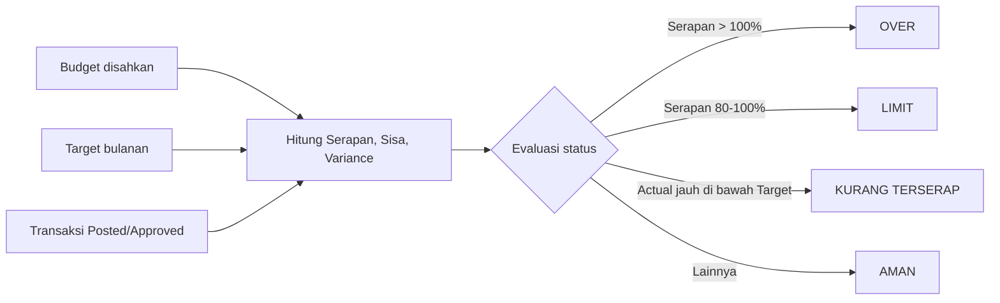
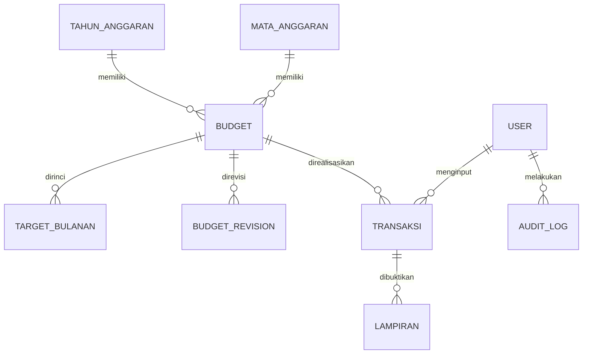
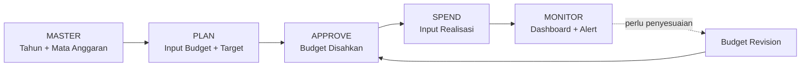

# SIGMA — Sistem Informasi &amp; Monitoring Anggaran

> **PANTAU, KENDALIKAN, PUTUSKAN** e-Budgeting Lite • Kesekretariatan

**Catatan dokumen:** Dokumen ini dikonversi dari presentasi *Sistem_Informasi_dan_Monitoring_Anggaran.pptx* (11 slide) dan diperdetail menjadi rencana kerja. Isi yang berasal langsung dari slide ditandai **[Slide]**. Isi yang merupakan pengembangan/usulan ditandai **[Usulan]** dan perlu dikonfirmasi oleh pemilik proses sebelum menjadi keputusan final.

---

## Daftar Isi

1. [Latar Belakang &amp; Masalah](https://claude.ai/chat/2327d90f-ec8e-4576-8c9e-615575eebb11#1-latar-belakang--masalah)
2. [Tujuan Sistem](https://claude.ai/chat/2327d90f-ec8e-4576-8c9e-615575eebb11#2-tujuan-sistem)
3. [Ruang Lingkup &amp; Batasan](https://claude.ai/chat/2327d90f-ec8e-4576-8c9e-615575eebb11#3-ruang-lingkup--batasan)
4. [Konsep Inti &amp; Rumus](https://claude.ai/chat/2327d90f-ec8e-4576-8c9e-615575eebb11#4-konsep-inti--rumus)
5. [Modul Sistem](https://claude.ai/chat/2327d90f-ec8e-4576-8c9e-615575eebb11#5-modul-sistem)
6. [Struktur Data](https://claude.ai/chat/2327d90f-ec8e-4576-8c9e-615575eebb11#6-struktur-data)
7. [Dashboard Utama](https://claude.ai/chat/2327d90f-ec8e-4576-8c9e-615575eebb11#7-dashboard-utama)
8. [Monitoring: Budget vs Target vs Actual](https://claude.ai/chat/2327d90f-ec8e-4576-8c9e-615575eebb11#8-monitoring-budget-vs-target-vs-actual)
9. [Business Rules](https://claude.ai/chat/2327d90f-ec8e-4576-8c9e-615575eebb11#9-business-rules)
10. [Workflow &amp; Hak Akses](https://claude.ai/chat/2327d90f-ec8e-4576-8c9e-615575eebb11#10-workflow--hak-akses)
11. [Rencana Pengembangan per Fase](https://claude.ai/chat/2327d90f-ec8e-4576-8c9e-615575eebb11#11-rencana-pengembangan-per-fase)
12. [Kebutuhan Non-Fungsional](https://claude.ai/chat/2327d90f-ec8e-4576-8c9e-615575eebb11#12-kebutuhan-non-fungsional)
13. [Risiko &amp; Mitigasi](https://claude.ai/chat/2327d90f-ec8e-4576-8c9e-615575eebb11#13-risiko--mitigasi)
14. [Indikator Keberhasilan](https://claude.ai/chat/2327d90f-ec8e-4576-8c9e-615575eebb11#14-indikator-keberhasilan)
15. [Asumsi, Celah &amp; Pertanyaan Terbuka](https://claude.ai/chat/2327d90f-ec8e-4576-8c9e-615575eebb11#15-asumsi-celah--pertanyaan-terbuka)

---

## 1. Latar Belakang &amp; Masalah

**[Slide]** Masalah utama bukan sekadar pencatatan, tetapi **kemampuan membaca kondisi anggaran dengan cepat**.

### 1.1 Kondisi saat ini vs kondisi yang dituju

| Aspek         | Kondisi Saat Ini                                                        | Kondisi yang Dituju                                         |
| ------------- | ----------------------------------------------------------------------- | ----------------------------------------------------------- |
| Sumber data   | Monitoring anggaran tersebar di spreadsheet dan laporan                 | Satu dashboard untuk melihat kondisi seluruh anggaran       |
| Rekonsiliasi  | Pengecekan budget vs realisasi memerlukan waktu dan rekonsiliasi manual | Realisasi otomatis mengurangi saldo budget                  |
| Deteksi limit | Sulit mengidentifikasi mata anggaran yang mendekati limit               | Status langsung terbaca: aman, kurang terserap, limit, over |
| Over budget   | Baru terlihat setelah dilakukan pengecekan                              | Pimpinan dapat fokus pada area yang perlu perhatian         |
| Early warning | Belum ada peringatan dini untuk anggaran yang kurang terserap           | Peringatan otomatis berdasarkan target dan serapan          |
| Keterlacakan  | —                                                                       | Data transaksi dapat ditelusuri sampai bukti pengeluaran    |

### 1.2 Dampak jika tidak diselesaikan **[Usulan]**

- Keputusan pengeluaran diambil dengan data yang terlambat atau tidak seragam.
- Over budget baru diketahui setelah uang keluar, sehingga hanya bisa dikoreksi, tidak bisa dicegah.
- Anggaran yang kurang terserap baru disadari di akhir tahun, sehingga berisiko tidak termanfaatkan atau menumpuk di kuartal akhir.
- Waktu staf habis untuk menyusun dan mencocokkan laporan manual, bukan untuk analisis.

---

## 2. Tujuan Sistem

**[Slide]** Versi *Lite*, tetapi cukup kuat untuk menjadi alat kontrol manajemen.

| No  | Tujuan            | Penjelasan                                                    | Contoh Ukuran Capaian **\[Usulan\]**                               |
| --- | ----------------- | ------------------------------------------------------------- | ------------------------------------------------------------------ |
| 01  | **Kontrol**       | Menjaga realisasi tetap berada dalam anggaran yang disepakati | Tidak ada transaksi yang menyebabkan over budget tanpa terdeteksi  |
| 02  | **Visibilitas**   | Melihat budget, realisasi, sisa dan serapan dalam satu layar  | Kondisi anggaran terbaca &lt; 1 menit dari dashboard               |
| 03  | **Early Warning** | Mendeteksi limit, over budget dan kurang terserap lebih awal  | Warning muncul otomatis saat ambang batas tercapai                 |
| 04  | **Akuntabilitas** | Menyimpan histori transaksi dan perubahan data secara terukur | Setiap perubahan penting tercatat di audit log (siapa, kapan, apa) |

---

## 3. Ruang Lingkup &amp; Batasan

### 3.1 Di dalam lingkup

- Pengelolaan master tahun anggaran dan mata anggaran.
- Penetapan budget tahunan dan target penyerapan bulanan.
- Pencatatan realisasi pengeluaran beserta bukti transaksi.
- Perhitungan otomatis sisa, serapan, variance, dan status.
- Dashboard, monitoring, dan laporan.
- Manajemen user, role, dan audit trail.

### 3.2 Di luar lingkup (sengaja)

**[Slide]** *Rancangan sederhana. Tidak masuk ke wilayah accounting atau ERP.*

Artinya sistem ini **bukan**:

- Pengganti sistem akuntansi / buku besar (general ledger).
- Sistem pengadaan, inventori, atau pembayaran.
- Sistem penggajian atau perpajakan.

Hubungan dengan sistem keuangan resmi baru dipertimbangkan di Phase 3 (Integrasi Finance).

### 3.3 Pengguna &amp; pemangku kepentingan **[Usulan]**

| Peran                                   | Kepentingan                                                                      |
| --------------------------------------- | -------------------------------------------------------------------------------- |
| Pimpinan                                | Melihat kondisi anggaran dan area yang butuh perhatian untuk mengambil keputusan |
| Pengelola anggaran (Kesekretariatan)    | Mencatat realisasi, memantau, menyusun laporan                                   |
| Admin sistem                            | Mengelola master data, user, dan konfigurasi                                     |
| Auditor / pemeriksa internal (opsional) | Menelusuri transaksi dan histori perubahan                                       |

---

## 4. Konsep Inti &amp; Rumus

**[Slide]** Sistem membandingkan **rencana** dengan **realisasi**, lalu menerjemahkannya menjadi **status** yang mudah dipahami.

### 4.1 Komponen dasar

| Komponen   | Definisi                       |
| ---------- | ------------------------------ |
| **Budget** | Anggaran yang telah disepakati |
| **Target** | Rencana penyerapan per periode |
| **Actual** | Realisasi pengeluaran          |
| **Status** | Aman • Kurang • Limit • Over   |

### 4.2 Rumus

| Indikator         | Rumus                    | Arti                                                     |
| ----------------- | ------------------------ | -------------------------------------------------------- |
| **Sisa Anggaran** | `Budget − Actual`        | Dana yang masih dapat digunakan                          |
| **Serapan (%)**   | `Actual ÷ Budget × 100%` | Seberapa besar budget sudah terpakai                     |
| **Variance**      | `Actual − Target`        | Selisih realisasi terhadap rencana pada periode berjalan |

### 4.3 Cara membaca variance

- **Variance negatif** → realisasi tertinggal dari target (potensi *kurang terserap*).
- **Variance positif** → realisasi melampaui target (potensi *limit/over*).

> **Mengapa target penting:** Target membedakan **"serapan rendah"** dengan **"serapan memang belum waktunya"**. Serapan 30% di bulan Maret bisa normal, tetapi serapan 30% di bulan Oktober adalah masalah.

### 4.4 Diagram alur logika **[Usulan]**

---

## 5. Modul Sistem

**[Slide]** Enam modul inti.

| No  | Modul                | Fungsi Utama (Slide)                         | Rincian Fitur **\[Usulan\]**                                                                                                                    |
| --- | -------------------- | -------------------------------------------- | ----------------------------------------------------------------------------------------------------------------------------------------------- |
| 01  | **Dashboard**        | Ringkasan kondisi anggaran dan warning       | Kartu KPI (Total Budget, Realisasi, Sisa, Serapan); grafik Budget vs Realisasi bulanan; ringkasan Budget Health; daftar mata anggaran prioritas |
| 02  | **Master Anggaran**  | Tahun, mata anggaran, budget dan target      | CRUD tahun anggaran; CRUD mata anggaran (kode, nama, status aktif); input budget tahunan; input target bulanan; pengesahan budget               |
| 03  | **Realisasi**        | Pencatatan pengeluaran dan bukti transaksi   | Form input transaksi; status Draft/Posted/Approved/Cancelled; lampiran bukti; validasi terhadap sisa budget                                     |
| 04  | **Monitoring**       | Budget vs target vs actual per mata anggaran | Tabel monitoring dengan status berwarna; filter periode dan mata anggaran; drill-down ke transaksi                                              |
| 05  | **Laporan**          | Rekap transaksi, serapan dan exception       | Rekap transaksi; rekap serapan per mata anggaran/periode; laporan exception (limit, over, kurang terserap); export Excel                        |
| 06  | **User &amp; Audit** | Role, hak akses dan histori perubahan        | Manajemen user dan role; log perubahan (siapa, kapan, apa, nilai sebelum/sesudah)                                                               |

---

## 6. Struktur Data

### 6.1 Entitas inti **[Slide]**

| Entitas        | Contoh dari Slide             |
| -------------- | ----------------------------- |
| Tahun Anggaran | 2026                          |
| Mata Anggaran  | ATK • Transport • Maintenance |
| Budget         | Rp50 jt                       |
| Target Bulanan | Jan–Des                       |
| Transaksi      | Pengeluaran                   |
| Audit Log      | Siapa • Kapan • Apa           |

### 6.2 Rancangan tabel **[Usulan]**

| Tabel             | Field Utama                                                                                         | Keterangan                                              |
| ----------------- | --------------------------------------------------------------------------------------------------- | ------------------------------------------------------- |
| `tahun_anggaran`  | id, tahun, status (Draft/Aktif/Ditutup)                                                             | Satu tahun aktif pada satu waktu direkomendasikan       |
| `mata_anggaran`   | id, kode, nama, deskripsi, is\_aktif                                                                | Master kategori pengeluaran                             |
| `budget`          | id, tahun\_id, mata\_anggaran\_id, nilai, status (Draft/Disahkan), disahkan\_oleh, disahkan\_pada   | Unik per (tahun, mata anggaran); nilai ≥ 0              |
| `target_bulanan`  | id, budget\_id, bulan (1–12), nilai\_target                                                         | Total 12 bulan sebaiknya = nilai budget (validasi)      |
| `budget_revision` | id, budget\_id, nilai\_lama, nilai\_baru, alasan, diajukan\_oleh, disetujui\_oleh, tanggal          | Pengganti edit langsung pada budget yang sudah disahkan |
| `transaksi`       | id, budget\_id, tanggal, nominal, deskripsi, status (Draft/Posted/Approved/Cancelled), dibuat\_oleh | Hanya Posted/Approved yang dihitung sebagai realisasi   |
| `lampiran`        | id, transaksi\_id, nama\_file, path, ukuran, diunggah\_oleh                                         | Bukti pengeluaran (Phase 2)                             |
| `user`            | id, nama, email, role, is\_aktif                                                                    | Role: Admin, Pengelola, Viewer/Pimpinan                 |
| `audit_log`       | id, user\_id, waktu, aksi, entitas, entitas\_id, nilai\_lama, nilai\_baru                           | Tidak boleh diedit atau dihapus                         |
| `notifikasi`      | id, budget\_id, jenis, pesan, status\_baca, waktu                                                   | Phase 2                                                 |

**Prinsip data:** Sisa, serapan, variance, dan status **dihitung** dari budget, target, dan transaksi (tidak disimpan sebagai angka yang diinput manual) agar selalu konsisten.

---

## 7. Dashboard Utama

### 7.1 Kartu ringkasan (contoh data dari Slide)

| Total Budget | Realisasi | Sisa     | Serapan |
| ------------ | --------- | -------- | ------- |
| Rp2,50 M     | Rp1,65 M  | Rp850 jt | 66%     |

Pengecekan: `Rp2,50 M − Rp1,65 M = Rp850 jt` ✅ dan `1,65 ÷ 2,50 = 66%` ✅.

### 7.2 Budget Health (contoh data dari Slide)

| Status          | Jumlah Mata Anggaran | Porsi |
| --------------- | -------------------- | ----- |
| Aman            | 15                   | 51,7% |
| Kurang terserap | 8                    | 27,6% |
| Mendekati limit | 4                    | 13,8% |
| Over budget     | 2                    | 6,9%  |
| **Total**       | **29**               | 100%  |

### 7.3 Grafik Budget vs Realisasi Bulanan

Grafik batang/garis yang membandingkan budget (atau target kumulatif) dengan realisasi per bulan.

### 7.4 Spesifikasi tambahan dashboard **[Usulan]**

- Filter global: tahun anggaran, periode (bulan s.d.), dan mata anggaran.
- Setiap kartu Budget Health dapat diklik untuk membuka daftar mata anggaran pada status tersebut.
- Warna konsisten: hijau = Aman, biru/kuning = Kurang terserap, oranye = Limit, merah = Over.
- Panel "Perlu Perhatian": 5 mata anggaran dengan status terburuk atau selisih terbesar.
- Tampilan responsif agar pimpinan dapat membuka di tablet/ponsel.
- Waktu pembaruan data ditampilkan ("Data per: tanggal/jam").

---

## 8. Monitoring: Budget vs Target vs Actual

**[Slide]** Kunci untuk membedakan *serapan rendah* dengan *serapan memang belum waktunya*.

### 8.1 Contoh tabel monitoring (target s.d. Oktober)

| Mata Anggaran | Budget | Target s.d. Okt | Actual | Variance | Status     |
| ------------- | ------: | ---------------: | ------: | --------: | ---------- |
| ATK           | 50 jt  | 40 jt           | 30 jt  | −10 jt   | **KURANG** |
| Transport     | 30 jt  | 25 jt           | 28 jt  | +3 jt    | **LIMIT**  |
| Maintenance   | 20 jt  | 15 jt           | 23 jt  | +8 jt    | **OVER**   |
| Konsumsi      | 40 jt  | 28 jt           | 12 jt  | −16 jt   | **KURANG** |

### 8.2 Analisis tiap baris **[Usulan]**

| Mata Anggaran | Serapan thd Budget | Capaian thd Target | Interpretasi                                 | Tindak Lanjut yang Disarankan                                                                 |
| ------------- | ------------------: | ------------------: | -------------------------------------------- | --------------------------------------------------------------------------------------------- |
| ATK           | 60%                | 75%                | Realisasi tertinggal dari rencana            | Konfirmasi apakah kebutuhan memang berkurang atau pembelian tertunda; pertimbangkan realokasi |
| Transport     | 93,3%              | 112%               | Melampaui rencana dan mendekati batas budget | Batasi pengeluaran baru; evaluasi sisa 2 jt untuk 2 bulan ke depan                            |
| Maintenance   | 115%               | 153%               | Sudah melewati budget (kelebihan 3 jt)       | Tinjau penyebab; ajukan Budget Revision atau tahan transaksi lanjutan                         |
| Konsumsi      | 30%                | 43%                | Jauh tertinggal dari rencana                 | Cek apakah kegiatan batal/tertunda; pertimbangkan realokasi                                   |

### 8.3 Fitur monitoring **[Usulan]**

- Pilihan periode "s.d. bulan" untuk menghitung target kumulatif otomatis.
- Pengurutan dan pemfilteran berdasarkan status dan variance.
- Drill-down: klik baris untuk melihat daftar transaksi yang membentuk angka *Actual*.
- Badge status berwarna dan ikon, tidak hanya warna (aksesibilitas).
- Export tabel monitoring ke Excel.

---

## 9. Business Rules

### 9.1 Aturan dari Slide

| No  | Aturan        | Ketentuan                                                                                   |
| --- | ------------- | ------------------------------------------------------------------------------------------- |
| 01  | **Budget**    | Budget tahunan tidak boleh negatif dan harus terkait dengan mata anggaran aktif             |
| 02  | **Realisasi** | Hanya transaksi berstatus Posted/Approved yang dihitung sebagai realisasi                   |
| 03  | **Saldo**     | Sisa = Budget − Total Realisasi                                                             |
| 04  | **Serapan**   | Serapan % = Total Realisasi ÷ Budget × 100%                                                 |
| 05  | **Warning**   | 80–99% = Mendekati Limit; &gt;100% = Over Budget                                            |
| 06  | **Revisi**    | Budget yang telah disahkan tidak diedit langsung; perubahan dicatat sebagai Budget Revision |

### 9.2 Aturan status lengkap **[Usulan]**

Slide mendefinisikan *Limit* dan *Over*, serta menyebut *Kurang terserap* dan *Aman*, tetapi belum memberi ambang untuk dua status terakhir. Berikut usulan yang konsisten dengan contoh data di Slide 8:

| Prioritas | Status              | Kondisi                                                                        |
| ---------: | ------------------- | ------------------------------------------------------------------------------ |
| 1         | **Over Budget**     | Serapan &gt; 100%                                                              |
| 2         | **Mendekati Limit** | Serapan 80% – 100%                                                             |
| 3         | **Kurang Terserap** | Actual &lt; 80% dari Target s.d. periode berjalan (ambang dapat dikonfigurasi) |
| 4         | **Aman**            | Selain kondisi di atas                                                         |

Status dievaluasi **berurutan dari prioritas tertinggi**; satu mata anggaran hanya memiliki satu status.

**Uji terhadap contoh Slide 8:**

| Mata Anggaran | Serapan | Actual ÷ Target | Hasil Aturan    | Sesuai Slide? |
| ------------- | -------: | ---------------: | --------------- | :-------------: |
| ATK           | 60%     | 75%             | Kurang Terserap | ✅             |
| Transport     | 93,3%   | 112%            | Mendekati Limit | ✅             |
| Maintenance   | 115%    | 153%            | Over Budget     | ✅             |
| Konsumsi      | 30%     | 43%             | Kurang Terserap | ✅             |

### 9.3 Aturan tambahan **[Usulan]**

| Area                   | Aturan                                                                                                                                                                                             |
| ---------------------- | -------------------------------------------------------------------------------------------------------------------------------------------------------------------------------------------------- |
| Transaksi              | Nominal harus &gt; 0; tanggal tidak boleh di luar tahun anggaran; transaksi harus terhubung ke budget yang sudah disahkan                                                                          |
| Over budget            | Sistem **memberi peringatan** saat transaksi akan melewati sisa budget; keputusan apakah transaksi tetap boleh di-*posting* (blokir atau izinkan dengan alasan) perlu ditetapkan (lihat Bagian 15) |
| Pembatalan             | Transaksi Posted/Approved tidak dihapus, hanya diubah menjadi **Cancelled** dengan alasan, dan dicatat di audit log                                                                                |
| Target                 | Total target 12 bulan harus sama dengan budget; jika berbeda, sistem menampilkan peringatan                                                                                                        |
| Penutupan tahun        | Tahun yang ditutup bersifat read-only                                                                                                                                                              |
| Mata anggaran nonaktif | Tidak dapat dipilih untuk budget/transaksi baru, tetapi histori tetap tersimpan                                                                                                                    |
| Revisi budget          | Wajib mencantumkan alasan; menyimpan nilai lama dan baru; berlaku setelah disetujui                                                                                                                |

---

## 10. Workflow &amp; Hak Akses

### 10.1 Alur kerja **[Slide]**

| Tahap       | Aktivitas                          | Output                |
| ----------- | ---------------------------------- | --------------------- |
| **MASTER**  | Menyiapkan tahun dan mata anggaran | Tahun + Mata Anggaran |
| **PLAN**    | Menginput budget dan target        | Input Budget + Target |
| **APPROVE** | Mengesahkan budget                 | Budget Disahkan       |
| **SPEND**   | Mencatat realisasi                 | Input Realisasi       |
| **MONITOR** | Memantau kondisi dan warning       | Dashboard + Alert     |

### 10.2 Status transaksi **[Slide + Usulan]**

| Status            | Memengaruhi Realisasi? | Keterangan                                          |
| ----------------- | :----------------------: | --------------------------------------------------- |
| Draft             | Tidak                  | Masih dapat diedit                                  |
| Posted / Approved | **Ya**                 | Masuk kalkulasi serapan                             |
| Cancelled         | Tidak                  | Dikeluarkan dari kalkulasi, histori tetap tersimpan |

### 10.3 Matriks hak akses

**[Slide]** tiga role. **[Usulan]** rincian matriks:

| Fitur                                | Admin | Pengelola | Viewer / Pimpinan |
| ------------------------------------ | :-----: | :---------: | :-----------------: |
| Kelola user &amp; role               | ✅     | ❌         | ❌                 |
| Kelola master (tahun, mata anggaran) | ✅     | ❌         | ❌                 |
| Input budget &amp; target            | ✅     | ❌\*       | ❌                 |
| Mengesahkan budget                   | ✅     | ❌         | ❌                 |
| Input / edit transaksi Draft         | ✅     | ✅         | ❌                 |
| Posting transaksi                    | ✅     | ✅         | ❌                 |
| Melihat dashboard &amp; monitoring   | ✅     | ✅         | ✅                 |
| Melihat &amp; export laporan         | ✅     | ✅         | ✅                 |
| Melihat audit log                    | ✅     | ❌         | ❌                 |

\* Dapat disesuaikan, mengikuti siapa yang berwenang menyusun budget.

### 10.4 Prinsip kontrol **[Slide]**

- Budget yang disahkan tidak boleh diedit sembarangan; perubahan melalui Budget Revision.
- Semua perubahan penting masuk Audit Log.
- Transaksi Draft tidak memengaruhi realisasi.

---

## 11. Rencana Pengembangan per Fase

**[Slide]** Bangun inti terlebih dahulu. Fitur lanjutan masuk setelah sistem terbukti dipakai.

### 11.1 Ringkasan fase

| Fase        | Nama      | Fokus                              | Fitur (Slide)                                                                                               |
| ----------- | --------- | ---------------------------------- | ----------------------------------------------------------------------------------------------------------- |
| **Phase 1** | Core MVP  | Sistem dasar yang bisa dipakai     | Login, role &amp; user; Tahun + mata anggaran; Budget &amp; realisasi; Dashboard; Filter &amp; export Excel |
| **Phase 2** | Control   | Penguatan kontrol dan peringatan   | Target bulanan; Kurang terserap; Warning/notification; Budget revision; Upload bukti; Audit trail           |
| **Phase 3** | Extension | Perluasan setelah terbukti dipakai | Approval workflow; WhatsApp/email alert; Forecasting; Multi-unit; Integrasi Finance; Commitment budget / PO |

### 11.2 Rincian Phase 1 — Core MVP **[Usulan]**

**Sasaran:** Pengguna dapat memasukkan budget dan realisasi, lalu melihat serapan dan sisa dalam dashboard.

| Fitur                     | Cakupan                                                        | Kriteria Selesai                                        |
| ------------------------- | -------------------------------------------------------------- | ------------------------------------------------------- |
| Login, role &amp; user    | Login email/password; 3 role; manajemen user oleh Admin        | User hanya dapat mengakses fitur sesuai role            |
| Tahun + mata anggaran     | CRUD tahun anggaran dan mata anggaran                          | Mata anggaran nonaktif tidak muncul di input baru       |
| Budget &amp; realisasi    | Input budget per mata anggaran; input transaksi dengan status  | Sisa dan serapan terhitung otomatis dan benar           |
| Dashboard                 | Kartu KPI, grafik bulanan, ringkasan status dasar (Limit/Over) | Angka dashboard cocok dengan hasil hitung manual contoh |
| Filter &amp; export Excel | Filter tahun, bulan, mata anggaran; export tabel               | File Excel terunduh dengan data sesuai filter           |

> Catatan: *Kurang terserap* membutuhkan target bulanan yang baru ada di Phase 2, sehingga di Phase 1 status yang tersedia hanya Aman, Limit, dan Over.

### 11.3 Rincian Phase 2 — Control **[Usulan]**

**Sasaran:** Sistem mampu memberi peringatan dini dan menjaga integritas data.

| Fitur                | Cakupan                                                     | Kriteria Selesai                                              |
| -------------------- | ----------------------------------------------------------- | ------------------------------------------------------------- |
| Target bulanan       | Input target Jan–Des per mata anggaran                      | Target kumulatif s.d. bulan tertentu terhitung otomatis       |
| Kurang terserap      | Status berdasarkan Actual vs Target                         | Status sesuai aturan di Bagian 9.2                            |
| Warning/notification | Notifikasi dalam aplikasi saat Limit, Over, Kurang terserap | Notifikasi muncul sekali per perubahan status, bukan berulang |
| Budget revision      | Form revisi, alasan, histori nilai                          | Budget disahkan tidak dapat diedit langsung                   |
| Upload bukti         | Lampiran PDF/gambar pada transaksi                          | Bukti dapat dibuka dari detail transaksi                      |
| Audit trail          | Pencatatan perubahan penting                                | Setiap perubahan budget/transaksi tercatat lengkap            |

### 11.4 Rincian Phase 3 — Extension **[Usulan]**

Fitur ini dimulai **hanya setelah** Phase 1–2 terbukti dipakai secara rutin.

| Fitur                  | Gambaran                                                                                 |
| ---------------------- | ---------------------------------------------------------------------------------------- |
| Approval workflow      | Persetujuan bertingkat untuk transaksi atau revisi budget                                |
| WhatsApp/email alert   | Peringatan dikirim ke penerima yang ditentukan                                           |
| Forecasting            | Proyeksi serapan akhir tahun berdasarkan tren realisasi                                  |
| Multi-unit             | Pemisahan anggaran per unit/bagian dengan hak akses terpisah                             |
| Integrasi Finance      | Sinkronisasi dengan sistem keuangan resmi                                                |
| Commitment budget / PO | Mencatat komitmen (PO) sebelum realisasi agar saldo mencerminkan dana yang sudah terikat |

### 11.5 Gerbang antar fase **[Usulan]**

| Gerbang     | Syarat Lanjut                                                                                            |
| ----------- | -------------------------------------------------------------------------------------------------------- |
| Phase 1 → 2 | MVP dipakai untuk pencatatan nyata minimal satu periode; angka dashboard divalidasi terhadap data manual |
| Phase 2 → 3 | Pengguna rutin memakai warning dan revisi; ada kebutuhan nyata yang terdokumentasi untuk fitur lanjutan  |

---

## 12. Kebutuhan Non-Fungsional **[Usulan]**

| Aspek                           | Kebutuhan                                                                                                                      |
| ------------------------------- | ------------------------------------------------------------------------------------------------------------------------------ |
| **Keamanan**                    | Autentikasi wajib; kata sandi di-*hash*; pembatasan akses berbasis role; sesi kedaluwarsa otomatis                             |
| **Integritas data**             | Perhitungan di sisi server; transaksi dan budget tidak dihapus permanen (soft delete/cancel); audit log bersifat *append-only* |
| **Kinerja**                     | Dashboard dimuat dalam beberapa detik untuk ratusan mata anggaran dan ribuan transaksi                                         |
| **Ketersediaan &amp; cadangan** | Backup basis data terjadwal dan uji pemulihan berkala                                                                          |
| **Kemudahan pakai**             | Antarmuka sederhana, bahasa Indonesia, dan responsif untuk tablet/ponsel                                                       |
| **Aksesibilitas**               | Status tidak hanya dibedakan lewat warna (ada label/ikon)                                                                      |
| **Ekspor**                      | Format Excel (.xlsx) dengan angka numerik asli, bukan teks                                                                     |
| **Kemudahan pemeliharaan**      | Ambang status (80%, 100%, ambang kurang terserap) disimpan sebagai pengaturan, bukan ditulis tetap di kode                     |
| **Kepatuhan**                   | Penyimpanan bukti dan histori sesuai kebijakan retensi organisasi                                                              |

---

## 13. Risiko &amp; Mitigasi **[Usulan]**

| Risiko                                     | Dampak                                     | Mitigasi                                                                                |
| ------------------------------------------ | ------------------------------------------ | --------------------------------------------------------------------------------------- |
| Pengguna tetap memakai spreadsheet paralel | Data ganda dan tidak konsisten             | Migrasi data awal; tetapkan sistem sebagai sumber tunggal; sosialisasi dan pendampingan |
| Realisasi terlambat diinput                | Dashboard tidak mencerminkan kondisi nyata | Tetapkan batas waktu input; tampilkan "data per tanggal" di dashboard                   |
| Target bulanan tidak realistis             | Status Kurang terserap menyesatkan         | Susun target bersama pemilik anggaran; tinjau di tengah tahun                           |
| Alert fatigue (terlalu banyak peringatan)  | Peringatan diabaikan                       | Notifikasi hanya saat status berubah; ambang dapat dikonfigurasi                        |
| Scope creep ke wilayah ERP/akuntansi       | Proyek membengkak dan terlambat            | Pegang batasan "Lite"; fitur lanjutan hanya masuk Phase 3 setelah terbukti              |
| Penyalahgunaan hak akses                   | Data diubah tanpa jejak                    | Role ketat dan audit log                                                                |
| Data awal tidak bersih                     | Angka awal salah                           | Validasi dan rekonsiliasi saat migrasi                                                  |

---

## 14. Indikator Keberhasilan **[Usulan]**

| Indikator                           | Cara Mengukur                                                          | Target Awal (contoh)                                |
| ----------------------------------- | ---------------------------------------------------------------------- | --------------------------------------------------- |
| Waktu penyusunan laporan monitoring | Perbandingan sebelum dan sesudah sistem                                | Berkurang signifikan (mis. dari hari menjadi menit) |
| Akurasi data                        | Selisih angka sistem vs rekonsiliasi manual                            | 0 selisih pada sampel pengecekan                    |
| Deteksi dini                        | Jumlah mata anggaran limit/over yang terdeteksi sebelum melewati batas | Meningkat dibanding kondisi awal                    |
| Adopsi                              | Persentase transaksi yang diinput melalui sistem                       | Mendekati 100%                                      |
| Kelengkapan bukti                   | Persentase transaksi yang memiliki lampiran (setelah Phase 2)          | Ditentukan bersama pemilik proses                   |
| Kepuasan pengguna                   | Umpan balik pengelola dan pimpinan                                     | Positif pada evaluasi akhir fase                    |

---

## 15. Asumsi, Celah &amp; Pertanyaan Terbuka

Bagian ini merangkum hal-hal yang ditemukan saat memperdetail slide dan perlu diputuskan.

### 15.1 Celah/ketidakkonsistenan pada slide

| No  | Temuan                                                                                           | Rekomendasi                                                                                              |
| --- | ------------------------------------------------------------------------------------------------ | -------------------------------------------------------------------------------------------------------- |
| 1   | **Batas 100% tepat** tidak terdefinisi: Limit = 80–99%, Over = &gt;100%                          | Tetapkan 100% sebagai *Mendekati Limit* (budget habis, belum melebihi) atau definisikan secara eksplisit |
| 2   | **Ambang "Kurang terserap"** tidak disebutkan                                                    | Gunakan ambang terkonfigurasi (usulan: Actual &lt; 80% dari Target)                                      |
| 3   | **Grafik dashboard** menampilkan Jan–Agu, sedangkan tabel monitoring memakai target s.d. Oktober | Samakan periode contoh agar konsisten                                                                    |
| 4   | **Prioritas status** jika satu mata anggaran memenuhi lebih dari satu kondisi                    | Terapkan urutan prioritas (Over &gt; Limit &gt; Kurang &gt; Aman)                                        |
| 5   | **Nama status** bervariasi: "Kurang"/"Kurang terserap", "Limit"/"Mendekati limit"                | Standarkan istilah di seluruh antarmuka                                                                  |
| 6   | **Phase 1** menyebut "Dashboard" tetapi "Kurang terserap" baru di Phase 2                        | Jelaskan bahwa dashboard Phase 1 hanya menampilkan status berbasis serapan (Aman/Limit/Over)             |
| 7   | **Audit trail** ada di struktur data inti, tetapi baru di Phase 2                                | Pertimbangkan audit log dasar sejak Phase 1 karena sulit ditambahkan belakangan                          |
| 8   | **Total budget contoh** Rp2,50 M, sedangkan contoh monitoring hanya 4 mata anggaran (Rp140 jt)   | Wajar sebagai cuplikan; pastikan data contoh diberi label                                                |

### 15.2 Pertanyaan yang perlu dijawab sebelum pengembangan

1. **Perlakuan saat over budget:** apakah transaksi yang melewati sisa budget diblokir, atau diizinkan dengan peringatan/alasan/persetujuan?
2. **Siapa yang mengesahkan budget** dan siapa yang menyetujui Budget Revision? (Pengelola, pimpinan, atau Admin)
3. **Granularitas anggaran:** hanya satu level mata anggaran, atau perlu sub-mata anggaran/kegiatan?
4. **Periode anggaran:** apakah selalu tahun kalender (Jan–Des), atau mengikuti tahun anggaran khusus?
5. **Status Posted vs Approved:** apakah keduanya dipakai berbeda (butuh persetujuan) atau cukup salah satu pada fase awal?
6. **Sumber data awal:** apakah data spreadsheet yang ada akan dimigrasikan, dan seperti apa kualitas datanya?
7. **Satuan unit:** apakah sistem dipakai oleh satu unit Kesekretariatan saja pada tahap awal?
8. **Kebijakan penyimpanan bukti:** format file, ukuran maksimum, dan masa retensi.
9. **Platform dan hosting (terjawab):** menggunakan *shared hosting* dari provider **Biznet**, dan perawatan sistem dilakukan oleh **tim dev**.
10. **Jumlah pengguna dan volume data** perkiraan, untuk menentukan kebutuhan infrastruktur.

### 15.3 Langkah berikutnya yang disarankan

1. Validasi aturan status (Bagian 9.2) dan jawab pertanyaan terbuka (Bagian 15.2) bersama pimpinan dan pengelola anggaran.
2. Kumpulkan sampel data anggaran dan realisasi tahun berjalan untuk uji perhitungan.
3. Buat *wireframe* dashboard, tabel monitoring, dan form realisasi.
4. Finalisasi spesifikasi Phase 1 dan susun estimasi waktu serta sumber daya.
5. Bangun MVP, uji dengan data nyata, lalu evaluasi sebelum masuk Phase 2.

---

*Dokumen ini disusun berdasarkan presentasi SIGMA — Sistem Informasi &amp; Monitoring Anggaran (e-Budgeting Lite • Kesekretariatan). Bagian bertanda [Usulan] adalah pengembangan dan belum merupakan keputusan.*