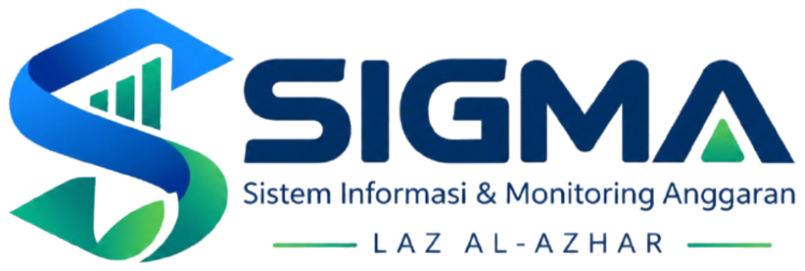

<p align="center">
  
</p>

<h1 align="center">SIGMA</h1>
<p align="center">
  <strong>Sistem Informasi & Monitoring Anggaran</strong><br>
  <em>Pantau, Kendalikan, Putuskan</em><br>
  <strong>LAZ Al Azhar Indonesia</strong>
</p>

<p align="center">
  
  
  
  
  
  
</p>

---

## 1. Deskripsi Sistem

**SIGMA (Sistem Informasi & Monitoring Anggaran)** adalah aplikasi web *internal e-budgeting* yang dirancang khusus untuk mengendalikan pengeluaran anggaran dan permohonan dana institusional di lingkungan **LAZ Al Azhar Indonesia**.

SIGMA mengintegrasikan seluruh siklus pengelolaan anggaran melalui satu rantai proses tunggal yang terlacak dan akuntabel:

$$\text{RAB / Kode Anggaran} \longrightarrow \text{Permohonan Dana} \longrightarrow \text{Persetujuan Berjenjang} \longrightarrow \text{Pencairan PPD} \longrightarrow \text{Laporan UMP} \longrightarrow \text{Realisasi \& Monitoring}$$

Sistem ini menjamin pencegahan pemakaian ganda anggaran (*double budgeting*), mendeteksi potensi *over budget* secara dini, dan menyediakan jejak audit append-only yang tidak dapat dimanipulasi.

---

## 2. Tech Stack & Arsitektur

- **Backend Framework:** Laravel 13 (PHP 8.3+)
- **Frontend Reactive Stack:** Blade Templates + Livewire 4.4 + Alpine.js
- **Styling & Design System:** Tailwind CSS 4 + Google Material Design 3 (M3) berbasis tonal palette brand Al-Azhar (Navy Kelembagaan `#0F2F57` & Emerald Zakat `#006C4C`)
- **Interaktivitas & Motion:** Motion One (`motion`) untuk transisi layer dan modal state
- **Database Engine:** MySQL 8 / MariaDB (Seluruh nilai plafon dan transaksi menggunakan `BIGINT` rupiah utuh untuk presisi finansial mutlak tanpa kesalahan floating point)
- **Reporting & Dokumen Cetak:**
  - `barryvdh/laravel-dompdf` v3.1: Form Permohonan Dana (A4 Landscape) dan Laporan UMP (A4 Portrait) berbasis tabel murni
  - `maatwebsite/excel` v4.0: Rekapitulasi Laporan Pengeluaran Bulanan Matriks 12 Bulan (.xlsx)
- **Pengujian Otomatis:** PHPUnit 12 / Pest (58+ Feature Tests terintegrasi, 100% PASS)

---

## 3. Fitur Utama yang Selesai (R0 s.d R2)

### A. Autentikasi & Antarmuka Material 3
- Desain *Liquid Glass M3*: Kanvas responsif dengan frosted glass backdrop blur, floating card login, dan active indicator pill.
- Autentikasi ganda via username atau email, proteksi rate limiting brute-force, dan penolakan instan akun nonaktif.
- Sidebar M3 dengan *independent viewport lock* (navigasi mandiri tanpa menggeser konten utama).

### B. Master Kode Anggaran & Plafon RAB Bertingkat
- Struktur hierarki pohon dinamis hingga 4 level (Induk Golongan, Sub-Golongan, Pos Rincian, Pos Leaf).
- Kalkulasi otomatis *bottom-up rollup* (anggaran efektif, dana terikat, realisasi, sisa tersedia, dan dana belum dialokasikan).
- Dialog inspeksi pos satu per satu (*Detail Modal M3*) untuk audit metrik spesifik pos anggaran.
- Filter multi-kriteria: pencarian teks instan, filter prefix kelompok (misal 2.4, 2.4.1), filter kedalaman level, filter pos leaf, dan filter kisaran nominal plafon.

### C. Laporan Pengeluaran Bulanan (Matriks 12 Bulan)
- Tabel matriks penyebaran anggaran Januari s.d Desember dengan akumulasi otomatis dari pos anak ke pos induk.
- Ekspor spreadsheet Excel (.xlsx) dengan styling rapi, header kelembagaan, dan pemformatan nominal akuntansi.

### D. Master Data Organisasi & Leveling
- Struktur organisasi resmi dua tingkat (`Divisi > Unit`):
  - **5 Divisi Induk Utama:** Divisi Sekretariat (`DIV-SEK`), Divisi Keuangan (`DIV-KEU`), Divisi Fundraising & Partnership (`DIV-FND`), Divisi Program (`DIV-PRG`), dan Divisi Wakaf (`DIV-WKF`).
  - **13 Unit Operasional:** Termasuk Unit Internal, Unit Eksternal, serta seluruh Kantor Perwakilan Wilayah (KPw Jateng, KPw Jatim, KPw Sulsel, KPw Sumbar, KPw Yogyakarta) di bawah Divisi Fundraising.
- Master Tahun Anggaran dengan status kontrol (Draft, Aktif, Ditutup).
- Skema Leveling 3 Tingkat berbasis batas kewenangan finansial:
  1. Supervisor: Rp0 - Rp2.000.000
  2. Manager: Rp2.000.001 - Rp10.000.000
  3. Kepala Divisi / Direktur Operasional: Di atas Rp10.000.000 (tanpa batas atas)
- Manajemen Pengguna & Leveling berbasis otorisasi ketat (Admin-only).

### E. Viewer Jejak Audit (Audit Trail Append-Only)
- Pencatatan otomatis setiap mutasi data finansial, user, dan status persetujuan.
- Penyimpanan append-only yang dilarang diubah atau dihapus di tingkat database/model.
- Dialog perbandingan data *Before vs After* terformat rapi (key-value diff dan raw JSON).

### F. Pengajuan Permohonan Dana (R2)
- Form Permohonan sesuai format fisik standar LAZ Al-Azhar.
- Input nama program diketik bebas dilengkapi autocomplete datalist suggestion.
- Searchable Combobox interaktif bertenaga Alpine.js untuk pencarian cepat pos anggaran leaf.
- Format titik ribuan otomatis pada input nominal rincian (`10.000.000`).
- Kartu informasi anggaran real-time dengan deteksi *over budget* otomatis dan validasi wajib catatan justifikasi (BR-8).
- Validasi wajib asnaf zakat untuk sumber dana Zakat (Amil / Program).

### G. Alur Persetujuan Berjenjang & Mode Proxy Keuangan (FR-PRX)
- Penunjukan atasan langsung yang fleksibel dengan rekomendasi otomatis Manager divisi terkait.
- Alur persetujuan bertingkat: Koordinator -> Manager -> Kadiv / Dirops -> Keuangan.
- Shortcut otomatis persetujuan: Pengajuan oleh Manager langsung dialihkan ke Kadiv / Dirops.
- Mode Input Atas Nama Keuangan (FR-PRX): Penyesuaian nominal disetujui per baris, pencatatan tanggal tanda tangan fisik, nama pejabat keuangan, dan unggah scan dokumen fisik bertanda tangan.

### H. Cetak Dokumen PDF Landscape Resmi
- Engine PDF A4 Landscape murni tabel (kompatibel penuh dengan dompdf tanpa flex/grid CSS).
- Memuat logo resmi Al-Azhar, alamat Head Office, nomor registrasi dokumen, rincian per pos, baris akumulasi TERPAKAI, 3 kotak tanda tangan basah (Diperiksa, Disetujui Keuangan, Dibuat), serta penanda status dokumen.

---

## 4. Panduan Instalasi Lokal

### Prasyarat Sistem
- PHP >= 8.3 dengan ekstensi: `pdo_mysql`, `mbstring`, `bcmath`, `gd`
- Composer >= 2.x
- Node.js >= 20.x & NPM
- MySQL >= 8.0 atau MariaDB >= 10.5

### Langkah Instalasi
1. Clone repositori ke komputer lokal:
   ```bash
   git clone <repository-url> sigma
   cd sigma
   ```

2. Salin environment konfigurasi:
   ```bash
   cp .env.example .env
   ```

3. Pasang dependensi PHP dan Node.js:
   ```bash
   composer install
   npm install
   ```

4. Buat Application Encryption Key:
   ```bash
   php artisan key:generate
   ```

5. Buat database baru di MySQL dengan nama `sigma_dev`, lalu sesuaikan kredensial di file `.env`:
   ```ini
   DB_CONNECTION=mysql
   DB_HOST=127.0.0.1
   DB_PORT=3306
   DB_DATABASE=sigma_dev
   DB_USERNAME=root
   DB_PASSWORD=
   ```

6. Jalankan migrasi database dan pengisian data master:
   ```bash
   php artisan migrate --seed
   ```

7. Bangun aset frontend:
   ```bash
   npm run build
   ```

8. Jalankan development server:
   ```bash
   php artisan serve
   ```
   Akses aplikasi melalui peramban di: `http://localhost:8000`

---

## 5. Akun Uji Coba Default (Lingkungan Lokal)

Semua akun uji coba di bawah ini menggunakan kata sandi standar: **`password`**

| Nama Pengguna | Username | Peran (Role) | Jabatan / Leveling | Divisi / Unit |
| :--- | :--- | :--- | :--- | :--- |
| **Administrator IT** | `admin` | admin | IT System Administrator (Supervisor) | Divisi Humas, GA, IT |
| **Koordinator IT** | `koordinator.it` | unit | Koordinator IT (Supervisor) | Unit IT (`UNT-IT`) |
| **Manager Humas, IT, GA** | `manager.humas` | unit | Manager Humas, IT, GA (Manager) | Divisi Humas, GA, IT (`DIV-HUM`) |
| **Rahmatullah Sidik** | `rahmatullah.sidik` | unit | Kepala Divisi / Dirops (Kadiv / Direksi) | Divisi Sekretariat (`DIV-SEK`) |
| **Rochadi Kohar** | `rochadi.kohar` | keuangan | Manajer Anggaran & Treasury (Manager) | Divisi Keuangan (`DIV-KEU`) |
| **Staf TU / Petugas Input** | `tu.sekretariat` | unit | Staf TU / Petugas Input Keuangan | Unit TU (`UNT-TU`) |

---

## 6. Standar Kepatuhan & Desain

1. **PSAK 109 (Akuntansi Zakat, Infak, dan Sedekah):**
   - Pemisahan tegas antara pos dana Zakat (8 Asnaf), dana Infak/Sedekah Terikat/Tidak Terikat, dan dana Amil (operasional kelembagaan).
2. **Google Material Design 3 (M3):**
   - Penerapan sistem token warna, surface container elevation, state layers (hover/focus/active), dan tipografi tabular angka finansial.
3. **Standar Aksesibilitas & Anti-Slop:**
   - Kontras warna memenuhi standar WCAG AA (rasio kontras >= 4.5:1 untuk teks normal).
   - Target sentuh minimum 44 x 44 piksel pada perangkat mobile.
   - 100% bebas karakter em dash pada seluruh berkas produksi.

---

## 7. Pengujian Otomatis

Untuk menjalankan seluruh rangkaian pengujian fitur:

```bash
php artisan test
```

Hasil status pengujian saat ini:
```
Tests:    58 passed (249 assertions)
Duration: ~10s
Status:   100% PASS
```

---

<p align="center">
  <strong>SIGMA &copy; 2024-2026 LAZ Al Azhar Indonesia</strong><br>
  <em>Kompleks Masjid Agung Al Azhar, Kebayoran Baru, Jakarta Selatan</em>
</p>
