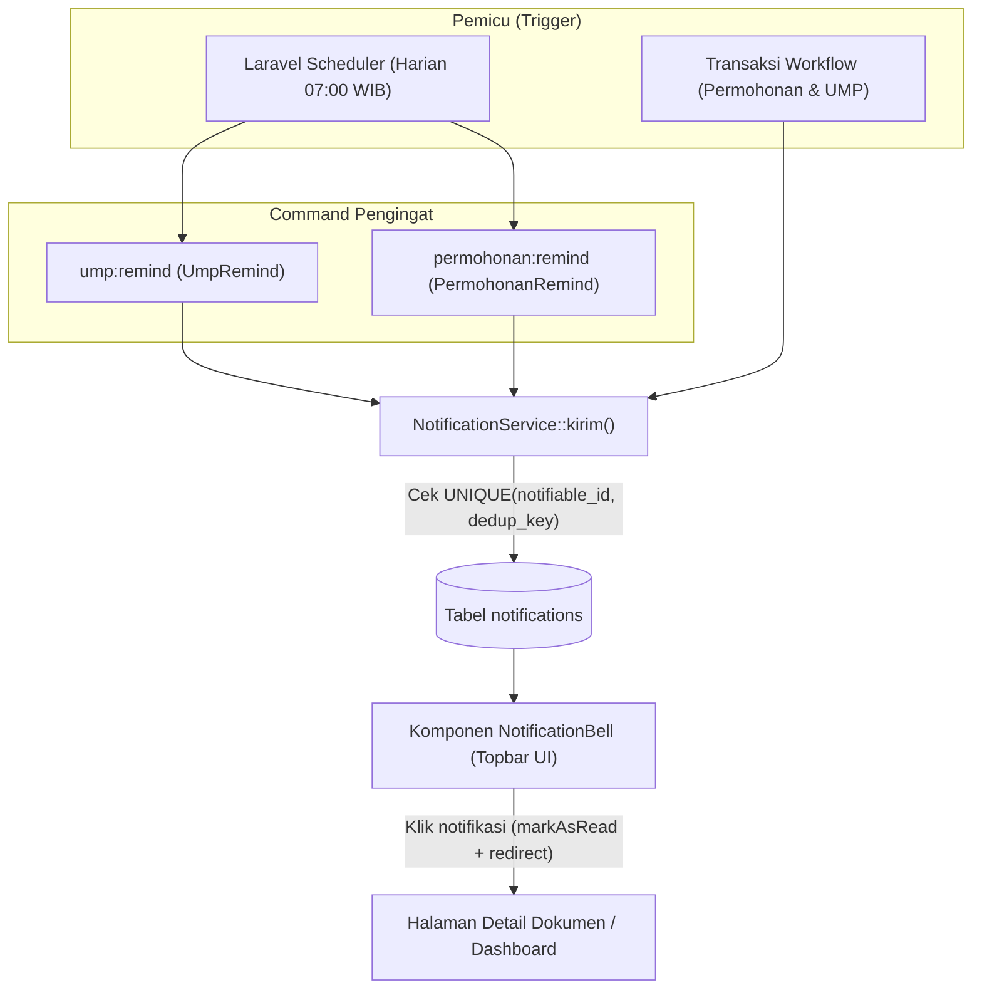

# Sistem Pengingat (Reminder) & Notifikasi — SIGMA

Dokumen ini menjelaskan cara kerja fitur **Pengingat (Reminder)** dan **Peringatan Sistem** yang berjalan di aplikasi **SIGMA (Sistem Informasi & Monitoring Anggaran)**.

---

## 1. Gambaran Umum

Seluruh pengingat di SIGMA dikirimkan melalui **Notifikasi Dalam Aplikasi (*In-App Notification*)** yang tersimpan pada tabel `notifications` dan ditampilkan melalui ikon lonceng (**Notification Bell**) di bilah atas aplikasi. Sesuai spesifikasi pada `PRD.md` (FR-NTF), pengiriman melalui kanal eksternal seperti Email atau WhatsApp belum diaktifkan sehingga seluruh pemberitahuan terpusat di dalam sistem.

Secara garis besar, mekanisme pengingat di SIGMA terbagi menjadi **3 lapisan**:

1. **Pengingat Terjadwal Otomatis (*Scheduled Reminders*)** — Berjalan otomatis setiap hari pukul **07:00 WIB** melalui Laravel Scheduler untuk memeriksa dokumen yang mendekati/melewati tenggat atau tertunda terlalu lama:
   - Pengingat Jatuh Tempo Laporan UMP (`ump:remind`)
   - Pengingat Permohonan Dana Tertunda (`permohonan:remind`)
2. **Peringatan & Notifikasi Transaksional (*Event-Driven Alerts*)** — Dikirim seketika (*real-time*) saat terjadi perubahan status dokumen atau saat pemakaian anggaran melewati batas ambang (**Limit** / **Over Budget**).
3. **Indikator Visual *Real-Time* di Antarmuka** — Penanda warna merah, label keterlambatan, dan panel antrean di Dashboard serta tabel transaksi yang dihitung langsung saat halaman dibuka (tetap akurat meskipun *cron job* belum berjalan).

### Prinsip Anti-Spam (Idempotensi `dedup_key`)
Untuk mencegah *alert fatigue* (notifikasi berulang setiap hari untuk masalah yang sama), setiap pengiriman melalui `App\Services\NotificationService::kirim()` dilengkapi **`dedup_key`** dengan aturan database `UNIQUE(notifiable_id, dedup_key)`.
- Satu jenis pengingat pada tahap/status yang sama **hanya dikirim satu kali** kepada masing-masing pengguna.
- Jika command pengingat dijalankan berulang kali di hari yang sama maupun hari berikutnya tanpa ada perubahan status, sistem otomatis mengabaikan duplikatnya.

---

## 2. Alur Arsitektur Pengingat



---

## 3. Pengingat Terjadwal Otomatis (*Scheduled Reminders*)

### 3.1. Pengingat Jatuh Tempo UMP (`ump:remind`)

- **Kelas Command:** `App\Console\Commands\UmpRemind` (`app/Console/Commands/UmpRemind.php`)
- **Fungsi:** Mengingatkan Penanggung Jawab (PJ) dan Pengaju agar segera menyelesaikan Laporan Uang Muka Perjalanan/Kegiatan (UMP) sebelum atau sesudah melewati tanggal jatuh tempo.
- **Penentuan Tanggal Jatuh Tempo:**
  Saat dana dicairkan (`PermohonanWorkflow::cairkan()`), sistem otomatis menetapkan `ump.jatuh_tempo = tgl_cair + ump.tenggat_hari` (default **14 hari**).
- **Syarat Aktif:**
  Pengaturan `ump.tenggat_hari` harus bernilai angka `> 0`. Apabila dikosongkan (`null`) atau `0`, fitur tenggat dianggap nonaktif dan command langsung berhenti tanpa mengirim notifikasi.
- **Kriteria Dokumen yang Diperiksa:**
  - Kolom `jatuh_tempo` tidak kosong (`NOT NULL`).
  - Status UMP **bukan** `selesai` dan **bukan** `dibatalkan` (artinya masih berstatus `draft`, `perlu_perbaikan`, `ttd_pj`, `ttd_manager_keuangan`, atau `ttd_kepala_keuangan`).

#### Kondisi Pemicu & Isi Pesan

| Kondisi | Rumus Selisih Hari (`diffDays = today -> jatuh_tempo`) | Status Tenggat | Contoh Pesan Notifikasi | `dedup_key` |
| --- | --- | --- | --- | --- |
| **Mendekati Jatuh Tempo** | `0 <= diffDays <= ump.pengingat_hari` (default H-3 s.d. Hari-H) | `mendekati` | *"Laporan UMP No. PPD {no_ppd} mendekati batas waktu jatuh tempo ({jatuh_tempo}). Sisa {diffDays} hari."* | `ump_tenggat_{ump_id}_mendekati` |
| **Melewati Jatuh Tempo** | `diffDays < 0` (sudah lewat tanggal jatuh tempo) | `lewat` | *"Laporan UMP No. PPD {no_ppd} telah melewati jatuh tempo ({jatuh_tempo}) sebanyak {hariLewat} hari."* | `ump_tenggat_{ump_id}_lewat` |

> **Catatan:** Karena `mendekati` dan `lewat` memiliki `dedup_key` berbeda, seorang PJ akan menerima **maksimal 2 kali pengingat** untuk satu dokumen UMP: 1 kali saat memasuki masa H-X sebelum jatuh tempo, dan 1 kali lagi apabila dokumen tersebut benar-benar melewati tanggal jatuh tempo.

- **Penerima Pengingat:**
  1. **Penanggung Jawab UMP** (`ump.pj`)
  2. **Pengaju Permohonan Dana** (`ump.pencairan.permohonan.user`), apabila pengaju berbeda orang dengan PJ.
- **Tampilan di Lonceng Notifikasi:** Tipe `ump_tenggat` dengan **ikon kalender berwarna oranye** dan tautan langsung ke halaman Detail UMP (`/ump/{id}`).

---

### 3.2. Pengingat Permohonan Dana Tertunda (`permohonan:remind`)

- **Kelas Command:** `App\Console\Commands\PermohonanRemind` (`app/Console/Commands/PermohonanRemind.php`)
- **Fungsi:** Mengingatkan pejabat penyetuju (*approver*) atau tim Keuangan apabila terdapat permohonan dana yang tertahan (*idle*) tanpa tindakan melebihi batas hari yang ditentukan.
- **Syarat Aktif:**
  Pengaturan `permohonan.pengingat_hari` bernilai angka `> 0` (default **3 hari**). Jika bernilai `null` atau `0`, fitur pengingat permohonan nonaktif.
- **Cara Menghitung Durasi Tertunda (`hariIdle`):**
  Sistem menghitung selisih hari penuh antara awal hari perubahan status terakhir (`permohonan.updated_at->startOfDay()`) hingga hari ini (`Carbon::today()`). Pengingat dikirim apabila:
  $$\text{hariIdle} \ge \text{permohonan.pengingat\_hari}$$

#### Target Tahap & Penerima Pengingat

| Status Permohonan | Label Tahap di Pesan | Pihak Penerima Pengingat |
| --- | --- | --- |
| `diajukan` | **Pemeriksaan Atasan** | Atasan langsung yang ditunjuk pada permohonan (`atasan_id`). Jika kosong, sistem mencari pengguna aktif di divisi terkait dengan `leveling.urutan >= 3` (Kadiv), atau *fallback* ke Manajer Unit. |
| `diketahui_kadiv` | **Verifikasi Keuangan** | Seluruh pengguna aktif dengan role `keuangan` atau `admin`. |
| `disetujui_keuangan` | **Pencairan Dana** | Seluruh pengguna aktif dengan role `keuangan` atau `admin`. |

- **Format Notifikasi:**
  - **Judul:** `Permohonan Dana Tertunda {hariIdle} Hari`
  - **Pesan:** `Permohonan {no_pengajuan} dari {nama_pengaju} sudah {hariIdle} hari menunggu tindakan di tahap {labelTahap}.`
  - **`dedup_key`:** `pengingat_permohonan_{permohonan_id}_{status}`
  - **Perilaku Lintas Tahap:** Karena `dedup_key` menyertakan `{status}`, pengingat dikirim 1 kali pada tahap yang sedang macet. Jika dokumen kemudian disetujui namun kembali tertahan ≥ X hari di tahap berikutnya (misal di tahap Pencairan Dana), sistem tetap dapat mengirimkan pengingat baru untuk tahap berikutnya tersebut.
- **Tampilan di Lonceng Notifikasi:** Tipe `permohonan_tertunda` dengan **ikon jam berwarna ungu (violet)** dan tautan langsung ke Detail Permohonan (`/permohonan/{id}`).

---

## 4. Notifikasi & Peringatan Berbasis Peristiwa (*Event-Driven*)

Selain kedua pengingat terjadwal di atas, sistem juga mengirimkan pemberitahuan instan ketika pengguna melakukan aksi di dalam alur kerja:

| Tipe Notifikasi (`type`) | Ikon UI | Kapan Dipicu | Penerima | Sumber Kode |
| --- | --- | --- | --- | --- |
| `dokumen_menunggu_tindakan` | Jam Kuning (*Amber*) | Saat Permohonan diajukan, naik ke tahap Kadiv/Keuangan, atau saat UMP diajukan PJ & diteruskan ke Keuangan. | Approver pada tahap tujuan (Manajer, Kadiv, Keuangan/Petugas Input). | `PermohonanWorkflow`, `UmpWorkflow` |
| `anggaran_berubah_status` | Segitiga Peringatan Merah (*Rose*) | Saat Permohonan disetujui Keuangan atau UMP selesai, dan serapan efektif pos anggaran menyentuh status **Limit** (≥ `ambang.limit`) atau **Over Budget** (≥ `ambang.over`). | Seluruh pengguna aktif ber-role `admin` dan `keuangan`. | `PermohonanWorkflow::approve()`, `UmpWorkflow::approve()` |
| `dokumen_diputuskan` | Centang Hijau (*Emerald*) | Saat Permohonan disetujui, dana dicairkan (PPD terbit), UMP disetujui/diminta revisi, atau saat staf ditunjuk sebagai Penerima Dana UMP. | Pengaju Permohonan, PJ UMP, atau Penerima Dana UMP (`ump_penerima`). | `PermohonanWorkflow`, `UmpWorkflow`, `UmpDetail` |

---

## 5. Indikator Pengingat Visual di Antarmuka (Tanpa Cron)

Sebagai pengaman tambahan apabila penjadwal (*cron*) server sedang tidak aktif atau notifikasi lonceng sudah ditandai dibaca, SIGMA tetap menampilkan peringatan visual secara langsung:

1. **Komponen Lonceng Notifikasi (`NotificationBell`)**
   - Menampilkan lencana merah (*badge*) jumlah notifikasi yang belum dibaca (`unreadCount`, hingga `99+`).
   - Menampilkan 20 notifikasi terbaru; klik pada item otomatis menandai sudah dibaca (`read_at`) dan mengarahkan pengguna ke halaman dokumen terkait.
   - Menyediakan tombol **"Tandai semua dibaca"**.
2. **Halaman Daftar & Detail UMP (`/ump` dan `/ump/{id}`)**
   - Tanggal jatuh tempo otomatis ditampilkan dengan **teks merah tebal** disertai keterangan **`(Lewat tenggat)`** apabila tanggal hari ini melewati `jatuh_tempo` dan status UMP belum `selesai`.
3. **Dashboard Eksekutif (`/dashboard`)**
   - **Panel "Antrean Persetujuan Saya":** Merangkum seluruh dokumen Permohonan dan UMP yang sedang menunggu keputusan dari pengguna yang sedang login.
   - **Panel "Perlu Perhatian":** Menampilkan 5 pos anggaran teratas yang berada pada kondisi kritis (**Over Budget** atau **Limit**).
4. **Export Excel Rekap PPD & UMP (`RekapPpdUmpExport`)**
   - Menyertakan kolom **`JATUH TEMPO`** dan **`STATUS TENGGAT`** (`Selesai`, `Lewat`, `Mendekati`, atau `Dalam Batas`).
   - *Catatan teknis:* Klasifikasi `Mendekati` pada ekspor Excel saat ini mengevaluasi sisa waktu `<= 3` hari secara tetap.

---

## 6. Konfigurasi Pengingat oleh Administrator

Administrator dapat menyesuaikan parameter pengingat kapan saja melalui menu **Pengaturan Sistem** (`/master/pengaturan`) tanpa perlu mengubah kode program:

| Key Pengaturan (`settings.key`) | Label pada Halaman Pengaturan | Nilai Default | Aturan Validasi | Fungsi terhadap Pengingat |
| --- | --- | --- | --- | --- |
| `ump.tenggat_hari` | Jatuh Tempo UMP (Hari) | `14` | `nullable`, integer ≥ 1 | Menentukan tanggal jatuh tempo UMP sejak tanggal cair. Kosongkan untuk menonaktifkan tenggat & pengingat UMP. |
| `ump.pengingat_hari` | Pengingat UMP Sebelum Jatuh Tempo (Hari) | `3` | `required`, integer ≥ 1 | Mengirim pengingat UMP mulai **H-X** sebelum tanggal jatuh tempo. |
| `permohonan.pengingat_hari` | Pengingat Permohonan Tertunda (Hari) | `3` | `required`, integer ≥ 1 | Mengirim pengingat ke *approver*/Keuangan jika permohonan tertahan **≥ X hari** pada satu tahap. |
| `ambang.limit` | Ambang Peringatan Limit (%) | `80` | `required`, 1–100 | Persentase pemakaian anggaran yang memicu peringatan status **Limit**. |
| `ambang.over` | Ambang Over Budget (%) | `100` | `required`, 1–200 | Persentase pemakaian anggaran yang memicu peringatan status **Over Budget**. |

---

## 7. Penjadwalan Server (Cron) & Cara Menjalankan Manual

### 7.1. Jadwal Otomatis (`routes/console.php`)
Kedua command pengingat telah didaftarkan untuk berjalan setiap hari pukul **07:00 WIB**:

```php
Schedule::command('ump:remind')->dailyAt('07:00');
Schedule::command('permohonan:remind')->dailyAt('07:00');
```

Agar jadwal tersebut dieksekusi otomatis di server produksi (cPanel), pastikan *Cron Job* setiap menit sudah terpasang:

```cron
* * * * * cd /home/<nama_akun>/sigma && php artisan schedule:run >> /dev/null 2>&1
```

### 7.2. Eksekusi Manual melalui Terminal (CLI)
Untuk keperluan pengujian lokal atau pemicuan manual oleh tim teknis:

```bash
# Menjalankan pengingat jatuh tempo UMP
php artisan ump:remind

# Menjalankan pengingat permohonan dana tertunda
php artisan permohonan:remind

# Melihat daftar jadwal command yang terdaftar
php artisan schedule:list
```

### 7.3. Eksekusi Manual Tanpa SSH (Shared Hosting)
Selama masa *setup* awal (saat variabel `.env` `ARTISAN_RUNNER_ENABLED=true`), tim teknis juga dapat memicu kedua command melalui peramban pada rute `/artisan-runner?key=<ARTISAN_KEY>`:
- Pilihan **10. Run ump:remind (Pengingat UMP)**
- Pilihan **11. Run permohonan:remind (Pengingat Permohonan)**

---

## 8. Referensi File Terkait

| File | Peran dalam Sistem Pengingat |
| --- | --- |
| `app/Console/Commands/UmpRemind.php` | Command `ump:remind` untuk evaluasi tenggat & pengiriman pengingat UMP. |
| `app/Console/Commands/PermohonanRemind.php` | Command `permohonan:remind` untuk evaluasi permohonan *idle* & pengiriman pengingat per tahap. |
| `routes/console.php` | Registrasi jadwal harian (`07:00`) untuk `ump:remind` dan `permohonan:remind`. |
| `app/Services/NotificationService.php` | Layanan terpusat penyimpanan notifikasi ke database secara idempoten (`dedup_key`). |
| `database/migrations/2026_10_20_000020_create_notifications_table.php` | Skema tabel `notifications` beserta indeks unik `(notifiable_id, dedup_key)`. |
| `app/Livewire/Components/NotificationBell.php` | Komponen Livewire penghitung, daftar dropdown, dan aksi baca notifikasi. |
| `resources/views/livewire/components/notification-bell.blade.php` | Tampilan lonceng notifikasi beserta pemetaan warna/ikon per tipe pengingat. |
| `app/Livewire/Master/PengaturanIndex.php` | Halaman Admin (`/master/pengaturan`) untuk mengubah parameter hari pengingat & ambang anggaran. |
| `app/Services/PermohonanWorkflow.php` | Penetapan `jatuh_tempo` saat pencairan serta pemicu notifikasi transisi Permohonan & status anggaran. |
| `app/Services/UmpWorkflow.php` | Pemicu notifikasi transisi persetujuan UMP & perubahan status anggaran. |
| `tests/Feature/NotificationTest.php` | Pengujian otomatis alur notifikasi, `ump:remind`, `permohonan:remind`, dan idempotensi. |
| `tests/Feature/PengaturanTest.php` | Pengujian otomatis halaman Pengaturan Sistem untuk konfigurasi pengingat. |
