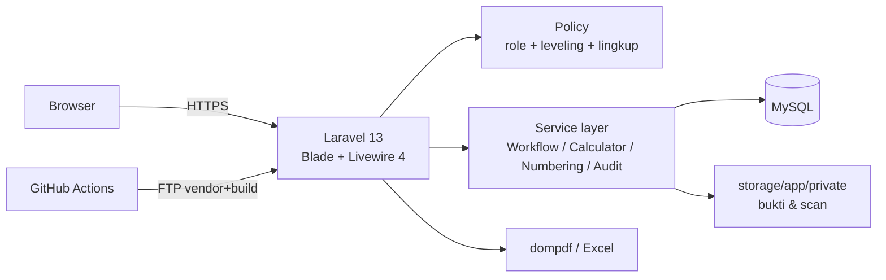

# TECH-SPEC — SIGMA E-Budgeting Lite

Versi 0.1 (draf) · 14 Oktober 2026 · Pasangan dokumen: `PRD.md` (apa & mengapa). Dokumen ini menjawab **bagaimana**. Label sama dengan PRD: **[D]** Disepakati, **[A]** Asumsi, **[T]** Terbuka.

## 1. Kendala Lingkungan

| Kendala | Nilai | Status | Dampak desain |
| --- | --- | --- | --- |
| Hosting | Shared hosting Biznet (cPanel) | [D] | Tanpa daemon, tanpa Node/Chrome di server |
| PHP | ≥ 8.3 | [D] | Laravel 13 memenuhi syarat |
| Akses | cPanel/FTP saja, **tanpa SSH/Composer** | [D] | `vendor/` dan asset di-build di CI, diunggah via FTP; migrasi lewat endpoint deploy (§7) |
| Cron | Tersedia | [D] | `schedule:run` tiap menit untuk pengingat UMP harian & cleanup (§5.6) |
| Database | MySQL 8 / MariaDB 10.6+ | [D] | Recursive CTE, `SELECT … FOR UPDATE`, JSON column tersedia |
| Pengguna | < 50 sekarang, bisa ~150 (seluruh karyawan) | [D] | Database driver untuk session/cache/queue cukup; VPS dipertimbangkan bila > 300 |
| Repo | GitHub | [D] | GitHub Actions untuk test + deploy |

## 2. Tech Stack [D]

| Lapisan | Pilihan | Alasan |
| --- | --- | --- |
| Framework | **Laravel 13** (PHP 8.3+) | Policy, transaksi DB + row lock, notifikasi database, ekosistem cetak/Excel |
| Frontend | **Blade + Livewire 4 + Alpine.js** | Satu bahasa; form multi-baris & validasi interaktif tanpa SPA |
| UI kit | **Tailwind CSS 4 + Flux (free)** | Bawaan starter kit Livewire |
| Grafik | **Chart.js** | Ringan, cukup untuk batang/garis bulanan |
| Auth | **Laravel Livewire starter kit**, registrasi publik dihapus | User hanya dibuat Admin (FR-AUTH-2) |
| Otorisasi | Kolom `users.role` + flag `is_petugas_input` + **Policy** | 5 role tetap; tanpa paket permission |
| Database | MySQL 8 / MariaDB 10.6+ | Tersedia di cPanel |
| Cetak | **barryvdh/laravel-dompdf** | PHP murni; Permohonan A4 landscape, UMP A4 portrait |
| Excel | **maatwebsite/excel** | Tipe angka/tanggal asli (FR-RPT) |
| Audit | Tabel `audit_logs` sendiri | Append-only terkendali (§5.5) |
| Berkas | Disk lokal **private** (`storage/app/private`) | Diakses hanya lewat controller ber-Policy |
| Testing | **Pest** | Bawaan Laravel 13 |
| CI/CD | GitHub Actions → FTP(S) | Tanpa SSH di server |
| Backup | JetBackup/cPanel + unduh manual mingguan | Tanpa paket tambahan |

Kompatibilitas paket dengan Laravel 13 / Livewire 4 diverifikasi saat `composer require` pertama [A]. Bila satu paket belum mendukung, kunci versi framework terakhir yang didukung, bukan ganti paket.

**Ekstensi PHP yang wajib aktif** (cek di cPanel › Select PHP Version): `ctype, curl, dom, fileinfo, filter, hash, mbstring, openssl, pcre, pdo_mysql, session, tokenizer, xml, zip, gd, bcmath`.

## 3. Arsitektur



Monolit tunggal. Tanpa API publik, tanpa SPA. Logika bisnis di `app/Services`, bukan di komponen Livewire, agar dashboard, layar, PDF, dan Excel memakai satu aturan (FR-CAL-1).

### 3.1 Struktur direktori (inti)

```
app/
  Enums/            Role, StatusPermohonan, StatusUmp, Tahap, SumberDana
  Models/
  Policies/         PermohonanPolicy, UmpPolicy, KodeAnggaranPolicy, LampiranPolicy
  Services/
    BudgetCalculator.php   # satu-satunya sumber angka Terikat/Realisasi/Sisa/Status
    PermohonanWorkflow.php # transisi 7.1, penentuan jenjang
    UmpWorkflow.php        # transisi 7.2
    Numbering.php          # ID pengajuan & saran nomor PPD/UMP
    AuditLogger.php
  Livewire/         per layar
  Exports/          kelas Excel
resources/views/pdf/  permohonan.blade.php (landscape), pencairan.blade.php (portrait), ump.blade.php (portrait)
```

## 4. Skema Database

Konvensi [D]: nominal **BIGINT** rupiah utuh (tanpa float/desimal); `created_by`/`updated_by` di tabel transaksi; data keuangan tidak pernah dihapus permanen (status `dibatalkan` / `is_active=false`); semua FK `restrictOnDelete`.

| Tabel | Kolom utama | Indeks / constraint |
| --- | --- | --- |
| `tahun_anggaran` | tahun, status (draft/aktif/ditutup) | unique(tahun); satu `aktif` dijaga di service |
| `units` | parent_id (null = Divisi Induk), kode, nama, tipe ('divisi' untuk induk, 'unit' untuk anak), sumber_dana_default_id, is_active | unique(kode) |
| `sumber_dana` | nama, butuh_asnaf (bool), is_active | — |
| `asnaf`, `program_utama` | nama, is_active | — (`program_utama` dipakai sebagai **Program** di header permohonan, T4) |
| `levelings` | nama, batas_bawah, batas_atas (BIGINT), urutan | unique(urutan) |
| `users` | name, username, email, password, role, leveling_id null, unit_id, jabatan, status_kepegawaian, is_petugas_input, is_active | unique(username), unique(email) |
| `kode_anggaran` | tahun_anggaran_id, parent_id, kode, nama, deskripsi, depth, plafon BIGINT null, budget_status (draft/disahkan), prev_year_id, is_active | unique(tahun_anggaran_id, kode) |
| `budget_revisions` (R5) | kode_anggaran_id, nilai_lama, nilai_baru, alasan, diusulkan_oleh, disetujui_oleh (role Keuangan, T2), disetujui_at | — |
| `budget_targets` (R5) | kode_anggaran_id, bulan, nilai | unique(kode_anggaran_id, bulan) |
| `permohonan` | no_pengajuan, unit_id, kode_anggaran_id, program, nama_kegiatan, tgl_mulai, tgl_selesai null, sumber_dana_id, status, total_diminta, total_disetujui, catatan_over, leveling_required_id, butuh_direksi (bool), perlu_verifikasi_keuangan (bool, T10), submitted_at | unique(no_pengajuan); idx(kode_anggaran_id, status) |
| `permohonan_items` | permohonan_id, uraian, asnaf_id null, program_utama_id null, jumlah_diminta, jumlah_disetujui null | CHECK jumlah_diminta > 0 |
| `approvals` | approvable_type/id (permohonan/ump), siklus, tahap, keputusan, approver_id, signer_name, signer_jabatan, signed_at, recorded_by, catatan | **unique(approvable_type, approvable_id, siklus, tahap)** |
| `pencairan` | permohonan_id, no_ppd, tgl_cair, jumlah, status, alasan_batal, perlu_verifikasi_keuangan (bool, T10) | unique(no_ppd); unique(permohonan_id) |
| `ump` | pencairan_id, tgl_terima, tujuan, pj_id, jumlah_total, total_penggunaan, saldo, pembulatan, kekurangan, status, jatuh_tempo, perlu_verifikasi_keuangan (bool, T10) | unique(pencairan_id) |
| `ump_items` | ump_id, tgl, rincian, no_bukti varchar(100) null, jumlah | CHECK jumlah > 0 |
| `lampiran` | attachable_type/id, jenis (bukti/scan_final/bukti_tf), path, original_name, mime, size, sha256, version, uploaded_by | idx(attachable_type, attachable_id) |
| `penomoran` | jenis ('pmh'), unit_id null, tahun, last_number | unique(jenis, unit_id, tahun) |
| `settings` | key, value (JSON) | unique(key) — ambang 80/100, tenggat UMP, pembulatan, mode Keuangan, ukuran berkas, max depth |
| `notifications` | bawaan Laravel (database channel) + dedup_key | unique(notifiable_id, dedup_key) |
| `audit_logs` | user_id, on_behalf_of, action, entity_type, entity_id, before JSON, after JSON, ip, user_agent, created_at | idx(entity_type, entity_id); **tanpa updated_at** |

#### Data Awal Leveling (Terkunci)
| Leveling | Batas Bawah | Batas Atas | Urutan |
| --- | --- | --- | --- |
| Supervisor | Rp0 | Rp2.000.000 | 1 |
| Manager | Rp2.000.001 | Rp10.000.000 | 2 |
| Kepala Divisi / Direktur Operasional | Rp10.000.001 | null (tanpa batas atas) | 3 |
`siklus` pada `approvals` naik setiap kali dokumen diajukan ulang setelah Perlu Perbaikan, sehingga riwayat lama tetap tersimpan dan jenjang dihitung ulang (PRD 7.1).

Kolom `signer_*` + `recorded_by` memenuhi FR-PRX-4 (dicatat oleh X atas nama Y) tanpa tabel tambahan; pada mode Langsung `recorded_by = approver_id`.

## 5. Keputusan Teknis per Kebutuhan

### 5.1 Perhitungan (FR-CAL) [D]

- `BudgetCalculator::forYear($tahun, $sdBulan, $filter)` menjalankan **satu query agregat per leaf** (Terikat dari permohonan berstatus Disetujui Keuangan/Dicairkan; Realisasi dari `ump_items` pada UMP Selesai), lalu menjumlahkan ke induk di PHP berdasarkan `parent_id`. Hasil tidak disimpan.
- Status per node dievaluasi berurutan sesuai PRD §5; status terburuk anak ikut dikembalikan.
- Cache per request saja. Bila > 1 detik pada data nyata, tambah cache 60 detik yang di-flush setiap transisi status — **jangan** tabel saldo terdenormalisasi.

### 5.2 Konkurensi & idempotensi (PRD §9) [D]

- Setiap transisi status: `DB::transaction` + `Permohonan::lockForUpdate()->find($id)`, cek status saat ini, baru tulis. Approver kedua menerima pesan "sudah diputuskan".
- Unique `approvals(…, siklus, tahap)` sebagai pengaman kedua di level DB.
- Tombol Ajukan memakai `wire:loading.attr="disabled"`; server tetap menolak transisi dari status selain Draft/Perlu Perbaikan.

### 5.3 Penomoran [D]

- ID pengajuan: **`{KODE_UNIT}-PMH-{TTTT}-{NNNN}`**, contoh `SEK-PMH-2026-0001`; urutan reset per unit per tahun, diambil dari `penomoran` dengan `lockForUpdate`.
- Nomor PPD/UMP: diketik manual oleh staf TU mengikuti fisik Keuangan (T9); sistem menjamin keunikan via index DB.

### 5.4 Otorisasi [D]

- `Gate::before` hanya untuk penolakan user nonaktif; Admin **tidak** otomatis lolos untuk aksi persetujuan.
- `PermohonanPolicy::approve` = role Pengguna Unit, satu divisi, `leveling.urutan ≥ leveling_required.urutan`, bukan pengaju, aktif. Tahap Keuangan: role Keuangan **atau** (`is_petugas_input` dan setting mode = `atas_nama`) dan bukan pengaju/PJ (FR-PRX-5).
- Tahap Direksi (T1 [D] Terkunci): Direksi = Kepala Divisi (Kepala Divisi Sekretariat merangkap Direktur Operasional). Leveling urutan 3 mencakup seluruh nominal > Rp10 juta tanpa batas atas. Tidak ada tahap terpisah `direksi` di antara Kadiv dan Keuangan; persetujuan unit tertinggi dilakukan langsung oleh Kepala Divisi / Dirops sebelum diteruskan ke Keuangan.
- Lingkup data lewat local scope `visibleTo($user)` yang dipakai di semua query daftar, dashboard, dan export.

### 5.5 Audit append-only [D]

- `AuditLogger::log()` dipanggil dari service (bukan observer otomatis) agar nilai sebelum/sesudah eksplisit.
- Model `AuditLog` melempar exception pada `updating`/`deleting`.
- [A] Bila cPanel mengizinkan, buat user MySQL aplikasi tanpa hak `UPDATE, DELETE` pada `audit_logs` (GRANT per tabel); bila tidak, cukup proteksi aplikasi + backup.

### 5.6 Notifikasi & penjadwalan [D]

- `QUEUE_CONNECTION=sync`: notifikasi transisi ditulis langsung dalam transaksi yang sama, tanpa worker.
- Cron cPanel tiap menit: `cd /home/<akun>/sigma && php artisan schedule:run`.
- `ump:remind` dijadwalkan harian 07:00: bila `ump.tenggat_hari` terisi, beri notifikasi untuk UMP mendekati (H-3) atau lewat `jatuh_tempo`, dengan `dedup_key` unik agar tidak berulang (FR-NTF). Bila tenggat nonaktif, command langsung keluar.
- Status "lewat tenggat" di daftar tetap **dihitung saat query** (`jatuh_tempo < today`), jadi tetap benar walau cron gagal.
- `jatuh_tempo` = `tgl_cair + ump.tenggat_hari`, dihitung saat pencairan; null bila tenggat nonaktif saat itu.

### 5.7 Berkas (FR-LMP) [D]

- Validasi: `mimes:jpg,jpeg,png,pdf` + `mimetypes` (cek isi via fileinfo) + `max` dari settings (default 5 MB).
- Nama disimpan `{uuid}.{ext}`; nama asli di DB; `sha256` untuk deteksi duplikat.
- Unduh via `LampiranController@show` → `authorize('view')` → `Storage::download`. Tanpa `storage:link`.
- Simpan berkas **sebelum** commit transaksi; bila gagal, transaksi di-rollback dan berkas yatim dihapus.
- Penggantian = baris `lampiran` baru dengan `version+1`; versi lama tidak dihapus.

### 5.8 Cetak (FR-CTK) [D]

- `Pdf::loadView('pdf.permohonan')->setPaper('a4','landscape')`; Pencairan dan UMP `portrait`.
- **Form Permohonan (A4 Landscape, persis fisik):**
  - Kiri atas: Logo Al Azhar + teks alamat Head Office. Kanan atas: Judul biru "FORM PERMOHONAN DANA" + kotak "Tanggal: [ ... ]".
  - Field: PROGRAM, NAMA KEGIATAN/DIVISI, TANGGAL KEGIATAN (s.d), SUMBER DANA di sisi kiri; MATA ANGGARAN di sisi kanan.
  - Tabel rincian: NO, URAIAN, ASNAF, PROGRAM UTAMA, JUMLAH PERMOHONAN, JUMLAH DISETUJUI.
  - Bawah tabel: baris "Terpakai [ ... ]" (realisasi kumulatif leaf saat cetak).
  - 3 kotak tanda tangan: Diperiksa Oleh (kiri), Disetujui Oleh (tengah), Dibuat Oleh (kanan).
  - Footer: "Copyright @2024" (kiri), "www.alazharpeduli.or.id" (kanan).
- **Laporan UMP (A4 Portrait, persis fisik):**
  - Kiri atas: Judul laporan (tujuan pengajuan). Kanan atas: Logo Al Azhar.
  - Meta: No. PPD / No. Uang Muka, Tanggal Penerimaan Dana, Tujuan Pengajuan, Penanggung Jawab.
  - Bagian A: JUMLAH DITERIMA (nominal rata kanan).
  - Bagian B: PENGGUNAAN DANA tabel: NO, TGL, RINCIAN PENGELUARAN, NO BUKTI (teks: transfer/nota), JUMLAH. Subtotal: TOTAL PENGGUNAAN DANA.
  - Bagian C: SALDO/DEFISIT (A - B).
  - Bagian D: Pembulatan Nominal.
  - 4 kotak tanda tangan (2 grup): Grup Unit: Dibuat oleh (PJ: nama, jabatan), Diperiksa Oleh (Kadiv: nama, jabatan); Grup Divisi Keuangan: Pemeriksa (Manajer Anggaran & Treasury: nama, jabatan), Disetujui Oleh (Kepala Keuangan: nama, jabatan).
- **Pencairan PPD (A4 Portrait, T5):** template formal pencairan kas/transfer.
- CSS dompdf terbatas: layout tabel murni, tanpa flex/grid. Font DejaVu Sans.

### 5.9 Excel (FR-RPT)

- Kelas `FromQuery` + `WithColumnFormatting` (nominal `#,##0`, tanggal `dd/mm/yyyy`); query sama dengan layar setelah filter dan `visibleTo`.
- Setiap export dicatat di audit log.

### 5.10 Keamanan

- CSRF, escaping Blade, Eloquent binding (bawaan Laravel).
- `APP_DEBUG=false` di produksi; `.env` hanya di server, tidak di repo.
- Rate limit login 5x/menit per username+IP.
- Session `SESSION_LIFETIME=120`, `SESSION_SECURE_COOKIE=true`, `http_only`.
- Livewire: properti sensitif (ID dokumen, status) diberi `#[Locked]`; otorisasi dicek ulang di setiap action, bukan hanya saat `mount`.

## 6. Pengaturan Default & Master Data

### 6.1 Pengaturan Sistem (tabel `settings`)

| Key | Default | Sumber |
| --- | --- | --- |
| `ambang.limit` / `ambang.over` | 80 / 100 (%) | PRD §5 |
| `pembulatan.kelipatan` / `arah` | 1000 / terdekat | **T3 terjawab** |
| `ump.tenggat_hari` | 14; null = nonaktif (Admin dapat mengubah atau mematikan) | T6 [A] |
| `approval.direksi_di_atas` | 100000000 | T1 |
| `approval.direksi_user_id` | null (Kadiv penyetuju terakhir) | T1 [T] |
| `keuangan.mode` | `atas_nama` | FR-PRX-1 |
| `lampiran.max_kb` | 5120 | A6 |
| `kode.max_depth` | 4 | FR-KDA-1 |

### 6.2 Master Data Struktur Organisasi (`Divisi > Unit`)

Struktur organisasi menggunakan relasi dua tingkat di tabel `units` di mana **Divisi adalah Induk (Parent)** dan **Unit adalah Anak (Child)**:

1. **5 Divisi Induk Utama** (`parent_id = null`, `tipe = 'divisi'`):
   - `DIV-SEK`: Divisi Sekretariat
   - `DIV-KEU`: Divisi Keuangan
   - `DIV-FND`: Divisi Fundraising & Partnership
   - `DIV-PRG`: Divisi Program
   - `DIV-WKF`: Divisi Wakaf

2. **Unit-unit Operasional Anak** (`parent_id` merujuk ke Divisi Induk, `tipe = 'unit'`):
   - Di bawah Divisi Sekretariat (`DIV-SEK`): `UNT-TU` (Unit Tata Usaha & Kesekretariatan), `UNT-IT` (Unit IT), `UNT-GA` (Unit General Affair & Logistik), `UNT-KOM` (Unit Komunikasi & Humas), `UNT-KLM` (Unit Kelembagaan), `UNT-DKL` (Unit Diklat & Litbang).
   - Di bawah Divisi Fundraising & Partnership (`DIV-FND`):
     - `UNT-FND-INT`: Unit Fundraising Internal
     - `UNT-FND-EKS`: Unit Fundraising Eksternal & Kemitraan
     - Seluruh Kantor Perwakilan Wilayah (KPw): `UNT-KPW-JTG` (KPw Jawa Tengah), `UNT-KPW-JTM` (KPw Jawa Timur), `UNT-KPW-SLS` (KPw Sulawesi Selatan), `UNT-KPW-SMB` (KPw Sumatera Barat), `UNT-KPW-YOG` (KPw D.I. Yogyakarta).
   - Di bawah Divisi Keuangan (`DIV-KEU`), Divisi Program (`DIV-PRG`), dan Divisi Wakaf (`DIV-WKF`): Unit-unit teknis operasional disiapkan sesuai mandat program masing-masing divisi.

## 7. Deploy (tanpa SSH) [D]

**Tata letak di server** [D] (akses hanya ke home; document root tidak diubah):

```
/home/<akun>/sigma/                 ← aplikasi produksi (di luar public_html)
/home/<akun>/sigma-staging/         ← aplikasi staging
/home/<akun>/public_html/<sub>/     ← isi public/ produksi; index.php menunjuk ../../sigma
/home/<akun>/public_html/<sub-stg>/ ← isi public/ staging; index.php menunjuk ../../sigma-staging
```

Folder subdomain dibuat lewat cPanel › Domains. `.env`, `vendor/`, `storage/` tidak pernah berada di bawah `public_html`.

**Pipeline GitHub Actions** (`.github/workflows/deploy.yml`):

1. Trigger: push ke `main` = deploy **staging**; push tag `v*` = deploy **produksi**. Secret FTP, URL, dan token terpisah per environment (GitHub Environments).
2. Job `test`: PHP 8.3 + service MySQL 8, `composer install`, `php artisan test`. Gagal = berhenti.
3. Job `build`: `composer install --no-dev --optimize-autoloader`, `npm ci && npm run build`.
4. Job `upload`: FTPS sinkron (mis. `SamKirkland/FTP-Deploy-Action`) **mengecualikan** `.env`, `storage/`, `node_modules/`, `tests/`. Folder `public/` diunggah ke folder subdomain, sisanya ke folder aplikasi.
5. Job `post-deploy`: `curl -X POST https://<domain>/_ops/deploy -H "X-Deploy-Token: $SECRET"`.

**Endpoint `/_ops/deploy`**:

- Hanya aktif bila `DEPLOY_TOKEN` di `.env` terisi; token ≥ 40 karakter, dibandingkan dengan `hash_equals`.
- Menjalankan `migrate --force`, `optimize:clear`, `optimize`; hasil dicatat di audit log.
- Tidak menerima parameter apa pun (tidak ada perintah artisan bebas).

> **Risiko keamanan:** endpoint ini mengeksekusi migrasi di produksi. Token bocor = penyerang bisa memicu migrasi (bukan eksekusi kode bebas). Rotasi token bila ada indikasi bocor; batasi dengan IP allowlist bila Biznet menyediakan IP keluar GitHub yang stabil (umumnya tidak).

**Setup pertama (manual sekali):** buat DB & user di cPanel → unggah `.env` lewat File Manager → set permission `storage/` dan `bootstrap/cache/` 775 → panggil `/_ops/deploy` → jalankan seeder awal (master, leveling, Admin) lewat endpoint yang sama dengan flag `--seed` hanya saat `APP_INSTALLED=false`.

**Rollback:** redeploy tag sebelumnya. Migrasi wajib punya `down()` yang aman; migrasi destruktif (drop kolom berisi data) dilarang dalam satu rilis dengan kode yang masih membacanya.

## 8. Backup [D]

- Harian: JetBackup/cPanel bawaan (cek retensi paket Biznet [T]).
- Mingguan: unduh manual dump DB + `storage/app/private` oleh tim dev ke penyimpanan kantor.
- Setiap rilis: uji restore ke lingkungan lokal; catat tanggal uji.
- Opsi bila backup cPanel tidak memadai: `spatie/laravel-backup` lewat scheduler ke Google Drive/S3.

## 9. Lingkungan & Konvensi Kerja

| Lingkungan | Keterangan |
| --- | --- |
| Lokal | Laragon/Herd (Windows), PHP 8.3, MySQL 8, Node LTS |
| Staging | [D] Subdomain kedua di hosting yang sama, DB & storage terpisah, data dummy; wajib lulus sebelum tag produksi |
| Produksi | Subdomain di Biznet, HTTPS (AutoSSL cPanel) |

- Branch: `main` selalu siap rilis; fitur di `feat/*` lewat PR; rilis = tag `vX.Y.Z`.
- Bahasa kode: Inggris untuk kode generik Laravel, **istilah domain dalam Bahasa Indonesia** (`Permohonan`, `Pencairan`, `Ump`, `KodeAnggaran`) agar cocok dengan PRD.
- `APP_LOCALE=id`, `APP_TIMEZONE=Asia/Jakarta`; format Rupiah lewat satu helper `rupiah($n)`.
- Lint: Laravel Pint di CI.

## 10. Strategi Pengujian

Fokus pada aturan yang mahal bila salah, bukan tampilan:

| Area | Contoh kasus wajib (Pest feature test) |
| --- | --- |
| Rumus | Lampiran B PRD: Budget 50 jt → Terikat 20 → UMP 18 → Sisa 32, Serapan 36% |
| Pohon | Induk 100 jt, anak 60+30 → Belum Dialokasikan 10; tambah anak 50 ditolak |
| Jenjang | 1,5 jt / 2 jt / 2,05 jt / 8 jt / 25 jt / 150 jt (dengan & tanpa `direksi_user_id`) → tahap & leveling sesuai Lampiran C |
| Konkurensi | Dua approve pada dokumen yang sama → satu tercatat |
| Otorisasi | Pengaju approve sendiri, petugas input catat dokumen sendiri, user lintas divisi → 403 |
| Berkas | Mime palsu (exe berganti nama .pdf) ditolak; akses tanpa hak → 403 |
| UMP | Penggunaan > dana cair → Realisasi penuh, kekurangan tercatat (T7) |
| Tahun ditutup | Semua mutasi ditolak |

Gerbang rilis = semua test hijau di CI pada MySQL (bukan SQLite, agar perilaku lock & CHECK sama dengan produksi).

## 11. Pertanyaan Teknis Terbuka

| No | Pertanyaan | Dampak bila tidak dijawab |
| --- | --- | --- |
| TT1 | Terjawab: cron tersedia | - |
| TT2 | Terjawab: akses home saja; pakai skema salin `public/` (§7) | - |
| TT3 | Terjawab: deploy via GitHub Actions FTP standar | - |
| TT4 | Kuota disk paket & retensi JetBackup? | Menentukan kapan pindah berkas ke object storage |
| TT5 | GRANT per tabel di MySQL cPanel diizinkan? | Audit append-only hanya di level aplikasi |
| TT6 | Terjawab: staging perlu (§9) | - |
| TT7 | Terjawab: Direksi = Kepala Divisi (Kepala Divisi Sekretariat merangkap Direktur Operasional), tidak ada tahap terpisah direksi, leveling urutan 3 tanpa batas atas | - |
